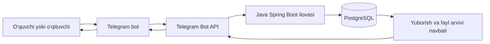

# EduPing — loyiha maqsadi, yechimlar va ishlash qoidalari

Sana: 2026-10-28  
Bot nomi: **EduPing**  
Telegram manzili: **@EduPingBot**  
Dastlabki ko‘lam: **bitta o‘qituvchi va uning bir nechta sinfi**.

## 1. Loyiha nima uchun yaratildi?

Bitta o‘qituvchiga ko‘p o‘quvchi murojaat qiladi. O‘qituvchining sinflari ham bir nechta bo‘lishi mumkin. Har bir o‘quvchi savolini, uy vazifasini, rasmini yoki ovozli xabarini o‘qituvchining shaxsiy Telegram chatiga yuborsa, ishga oid yozishmalar shaxsiy muloqot bilan aralashib ketadi.

Xabarlar ko‘paygan sari kim, qaysi sinfdan, nima haqida murojaat qilgani va unga javob berilgan-berilmaganini kuzatish qiyinlashadi. O‘qituvchi bir xil savolni qayta qidirishga, eski faylni topishga yoki qaysi o‘quvchi javob kutayotganini eslashga vaqt sarflaydi. O‘quvchi esa xabari qabul qilinganini bilmasdan qayta-qayta yozishi mumkin.

**EduPing shu muammoni hal qilish uchun yaratilgan: o‘quvchi murojaatini qabul qilish, sinf va o‘quvchiga bog‘lab saqlash, o‘qituvchiga tartibli ko‘rsatish va javobni bot orqali qaytarish.**

Bot o‘qituvchining shaxsiy chatiga yozish zaruratini kamaytiradi. Murojaatlar bitta ishchi kanalda yig‘iladi va ularning tarixi bazada saqlanadi.

## 2. Qanday muammolar yechiladi?

| Muammo | EduPing’dagi yechim |
| --- | --- |
| Ko‘p o‘quvchi o‘qituvchining shaxsiy chatiga yozadi | Murojaat va javoblar bot orqali almashiladi |
| Turli sinflarning savollari aralashadi | Har murojaat muayyan sinfga bog‘lanadi |
| Savolning kimga tegishli ekani yo‘qoladi | Murojaat o‘quvchining Telegram ID’siga bog‘lanadi |
| Javob kutayotgan murojaatlar unutiladi | Ochiq murojaatlar alohida ro‘yxatda ko‘rinadi |
| Eski javob yoki faylni topish qiyin | Murojaat raqami va yozishmalar tarixi mavjud |
| O‘quvchi xabari qabul bo‘lganini bilmaydi | Bazaga saqlangach qabul tasdig‘i yuborish navbatiga qo‘yiladi |
| Internet yoki Telegram’da vaqtinchalik xato bo‘ladi | Saqlangan navbat orqali qayta urinish bajariladi |
| Boshqa o‘quvchining ma’lumoti ochilib ketishi mumkin | Har murojaatga kirishda foydalanuvchi huquqi tekshiriladi |

## 3. Asosiy maqsad va kutiladigan natija

EduPing o‘qituvchi va o‘quvchi o‘rtasidagi murojaatlarni boshqaradigan Telegram botidir.

Loyihaning maqsadlari:

1. O‘qituvchining shaxsiy va darsga oid yozishmalarini ajratish.
2. O‘quvchilarga savol, uy vazifasi va tegishli fayllarni yuborish uchun tushunarli kanal berish.
3. Har murojaatga raqam berish, uni o‘quvchi va sinfga bog‘lash.
4. Murojaat, javob va qo‘llab-quvvatlanadigan fayllarni saqlash.
5. O‘qituvchiga murojaatlarni ko‘rish, javob berish va yopish imkonini berish.
6. Ma’lumotlarning boshqalarga ko‘rinishini cheklash va vaqtinchalik xatolardan keyin ishni davom ettirish.
7. Keyinchalik boshqa o‘qituvchilarni qo‘shishga mos tuzilmani saqlash.

Kutiladigan natija: o‘qituvchi kim, qaysi sinfdan va nima haqida yozganini ko‘radi; o‘quvchi esa qayerga yozishi va javobni qayerdan olishini biladi. Murojaat faqat Telegram chatidagi xabar bo‘lib qolmay, tarixga ega alohida yozuvga aylanadi.

## 4. Foydalanuvchilar va ularning vazifalari

### 4.1. O‘qituvchi

O‘qituvchi sinf yaratadi, taklif kodini o‘quvchilarga beradi, a’zolarni tekshiradi, murojaatlarni ko‘radi, javob yozadi va yakunlangan murojaatni yopadi.

O‘qituvchi huquqi sozlamadagi raqamli Telegram ID ro‘yxati orqali beriladi. Ism, username yoki o‘zini o‘qituvchi deb tanishtirish bu huquqni bermaydi.

Hozircha bitta o‘qituvchi bilan ishlash asosiy foydalanish holati. Tuzilmada har bir sinf o‘z o‘qituvchisiga bog‘langan; keyin boshqa o‘qituvchilarni sozlama orqali qo‘shish mumkin. O‘qituvchining mustaqil ro‘yxatdan o‘tishi yoki obuna tizimi hozir yo‘q.

### 4.2. O‘quvchi

O‘quvchi o‘qituvchi bergan kod bilan sinfga qo‘shiladi, tegishli sinf uchun murojaat ochadi, matn yoki fayl yuboradi, javoblarni o‘qiydi va ochiq murojaatini davom ettiradi.

Bir o‘quvchi bir nechta sinfga a’zo bo‘lishi mumkin. Yangi murojaat ochayotganda qaysi sinfga yozayotganini tanlaydi.

### 4.3. Texnik mas’ul

Texnik mas’ul dastur, PostgreSQL, ulanish sozlamalari, token, disk joyi va zarur zaxiralash ishlariga javob beradi. Oddiy foydalanish uchun o‘qituvchi SQL yoki server boshqaruvini bilishi shart emas.

Texnik mas’ul bazaga texnik kirishi mumkin. Shuning uchun botni mutlaqo anonim yoki faqat ikki kishigina texnik jihatdan o‘qiy oladigan tizim deb ta’riflash mumkin emas.

## 5. Asosiy ish jarayoni

### 5.1. Sinfga ulanish

1. O‘qituvchi «➕ Yangi sinf» tugmasini bosadi va sinf nomini yozadi.
2. Bot sinf kartasini beradi: taklif havolasi (`t.me/EduPingBot?start=KOD`) va kod.
3. O‘qituvchi havolani tegishli o‘quvchilarga ulashadi.
4. O‘quvchi havolani bosadi (yoki kodni botga yuboradi) va sinfga qo‘shiladi. Bot uning ism-familiyasini so‘raydi, ustoz ro‘yxatlarda shu ismni ko‘radi.
5. O‘qituvchi sinf kartasidagi «👥 O‘quvchilar» orqali a’zolarni tekshiradi va kerak bo‘lsa tasdiq bilan chiqaradi.

Taklif kodini bilish o‘quvchining haqiqiy shaxsini avtomatik tasdiqlamaydi. Kod tarqalib ketsa, o‘qituvchi uni yangilaydi va begona a’zolarni chiqaradi.

### 5.2. Murojaat yuborish

1. O‘quvchi «✍️ Yangi savol» ni bosadi. Bir nechta sinfi bo‘lsa sinfni tanlaydi.
2. Birinchi yuborilgan xabar murojaatni yaratadi va unga yagona raqam beriladi, masalan `#12`. Mavzu shu xabarning boshidan olinadi. Tugma bosilib hech narsa yozilmasa murojaat yaratilmaydi.
3. O‘quvchining keyingi matn yoki fayllari shu murojaatga yoziladi. Har saqlangan xabarga bot 👍 reaksiya qo‘yadi.
4. O‘qituvchiga ism, sinf va murojaat raqami bilan **tovushli** xabar keladi; ostida «Javob berish», «Tarix», «Yopish» tugmalari bo‘ladi.
5. O‘quvchi «✅ Tugatdim» ni bosadi. Murojaat javob va yakunlash uchun ochiq qoladi.

### 5.3. Javob berish va yopish

1. O‘qituvchi kelgan xabardagi «✍️ Javob berish» ni bosadi yoki «📥 Savollar» ro‘yxatidan murojaatni tanlaydi. Ro‘yxatda javob kutayotganlar (🔴) eng uzoq kutganidan boshlab birinchi turadi.
2. Javob matni yoki fayli saqlanadi va o‘quvchiga tovushli xabar bo‘lib boradi; ostida «Javob yozish» va «Hal bo‘ldi» tugmalari bo‘ladi.
3. Masala hal bo‘lgach murojaatni o‘qituvchi («✅ Yopish») yoki o‘quvchining o‘zi («✅ Hal bo‘ldi») yopadi. Ikkinchi tomon xabardor qilinadi.
4. Yopilgan murojaat tarixi saqlanadi; unga yangi xabar qo‘shilmaydi.

**Yozishni tugatish va murojaatni yopish turli amallardir.** «✅ Tugatdim» joriy yozish rejimidan chiqaradi. «Yopish» / «Hal bo‘ldi» murojaatni yakunlaydi.

## 6. Murojaatlarning holati va muloqot qoidalari

Murojaat ikki asosiy holatga ega:

- **OPEN** — ochiq, yozish va javob berish mumkin.
- **CLOSED** — yopilgan, tarix ko‘riladi, yangi xabar qo‘shilmaydi.

Har bir murojaat bitta sinf, bitta o‘quvchi va shu sinf o‘qituvchisiga tegishli. Javob berilgan murojaat o‘z-o‘zidan yopilmaydi. Uni o‘qituvchi yoki o‘quvchining o‘zi yakunlaydi; shu sababli o‘quvchi 5 ta ochiq murojaat chegarasida qolib ketmaydi.

Har bir foydalanuvchida bir vaqtda bitta faol yozish rejimi mavjud. Boshqa murojaat tanlansa, keyingi xabarlar yangi tanlangan murojaatga yoziladi. Tanlanmagan oddiy xabar hech kimga yuborilmaydi va saqlanmaydi: bot buni aniq aytadi va «Yangi savol» yoki oxirgi ochiq murojaatga qo‘shish tugmasini beradi.

O‘quvchi murojaat mavzusini tushunarli yozishi va bir masalaga oid xabarlarni bir murojaatda davom ettirishi kerak. Yangi, alohida masala uchun yangi murojaat ochiladi. Bot o‘qituvchi o‘rniga avtomatik javob bermaydi; javobni o‘qituvchi yozadi.

O‘qituvchi javob berish vaqtini sinfiga o‘zi bildiradi. Bot mavjudligi 24 soat ichida darhol inson javobi berilishini anglatmaydi. Hozir avtomatik ish vaqti jadvali yoki javob muddati nazorati kiritilmagan.

## 7. Kirish va foydalanish qoidalari

### O‘quvchi uchun

- Faqat o‘qituvchi bergan kod bilan tegishli sinfga qo‘shilish.
- O‘z murojaatlarini ko‘rish; boshqa o‘quvchining murojaatiga kira olmaslik.
- Matn yoki fayl yuborishdan oldin murojaatni ochish yoki davom ettirish.
- Yopilgan masaladan keyingi boshqa savol uchun yangi murojaat ochish.
- Masala hal bo‘lsa murojaatni «✅ Hal bo‘ldi» bilan yopish.
- Taklif kodini begonalarga tarqatmaslik, botga aloqasiz yoki maxfiy sirlarni yubormaslik.

### O‘qituvchi uchun

- Faqat o‘ziga tegishli sinf va murojaatlarni boshqarish.
- Sinf kodini faqat tegishli o‘quvchilarga berish va a’zolarni tekshirish.
- Javobni to‘g‘ri murojaat raqamiga yozish.
- Hal qilingan murojaatlarni yopish va ochiq qolganlarini kuzatish.
- Kod tarqalganida uni yangilash. Kodni yangilash mavjud a’zolarni avtomatik chiqarmaydi.
- Begona a’zoni chiqarish; qayta kirishining oldini olish kerak bo‘lsa kodni ham yangilash.

### Tizim uchun

- Faqat bot bilan shaxsiy chatdagi xabarlarni qayta ishlash.
- Guruh xabarlarini ushbu murojaatlar tizimiga qabul qilmaslik.
- Har safar sinf yoki murojaatga kirishda foydalanuvchi huquqini tekshirish.
- Huquq yetishmaganda boshqa foydalanuvchining xabar matnini yoki faylini ochmaslik.
- Noto‘g‘ri buyruq, qo‘llanmagan xabar turi va limit oshishiga tushunarli javob berish.

## 8. Qanday ma’lumotlar saqlanadi?

| Ma’lumot | Saqlashdan maqsad |
| --- | --- |
| Telegram ID va ko‘rinadigan ism | Foydalanuvchini aniqlash va huquqlarini tekshirish |
| O‘quvchi kiritgan ism-familiya | O‘qituvchi o‘quvchini taxallus emas, haqiqiy ismi bilan ko‘rishi |
| Sinf nomi, o‘qituvchisi va taklif kodi | Murojaatni tegishli sinfga yo‘naltirish |
| Sinf a’zoligi | Kim qaysi sinfga yozishi mumkinligini aniqlash |
| Murojaat raqami, mavzusi, holati va vaqti | Murojaatni hisobga olish va keyin topish |
| O‘quvchi xabarlari va o‘qituvchi javoblari | Yozishmalar tarixini saqlash |
| Fayl identifikatori, nomi, turi va hajmi | Faylni aniqlash va ko‘rsatish |
| Qo‘llab-quvvatlanadigan faylning baytlari va SHA-256 qiymati | Telegram havolasidan tashqari mustaqil arxiv nusxasini saqlash |
| Faol yozish rejimi | Dastur qayta yoqilganda tanlangan murojaatni eslab qolish |
| Texnik qabul/yuborish navbati, urinishlar va xato kodi | Uzilishdan keyin ishni davom ettirish |
| Muhim boshqaruv amallari qaydi | Sinf yaratish, qo‘shilish va yopish kabi amallarni kuzatish |

Biznes uchun kerakli qabul qilingan matn va metadata bazada saqlanadi. Fayl baytlarini yuklab arxivlash alohida bajariladi. Muvaffaqiyatli ishlangan texnik kiruvchi xabarning xom nusxasi tozalanadi, takrorni aniqlash uchun update ID qoladi.

Telegram’da xabarni o‘chirish yoki tahrirlash saqlangan tarixga avtomatik tatbiq etilmaydi. Sinfdan chiqarish oldingi murojaatlarni o‘chirmaydi: o‘quvchining ochiq murojaatlari yopiladi, u o‘z tarixini ko‘ra oladi, lekin yozolmaydi.

Avtomatik saqlash muddati va avtomatik o‘chirish hozir belgilanmagan. Ma’lumotni o‘chirish so‘rovi o‘qituvchi va texnik mas’ul orqali ko‘rib chiqiladi; zaxira nusxalaridagi holat ham hisobga olinadi.

## 9. Qabul qilinadigan xabarlar va amaldagi chegaralar

Qabul qilinadigan turlar: oddiy matn, foto, hujjat, video, audio, ovozli xabar, sticker, animatsiya va dumaloq video xabar.

| Chegara | Amaldagi qoida |
| --- | --- |
| Fayl hajmi | Bitta fayl ko‘pi bilan 20 MB |
| Ochiq murojaatlar | Bitta o‘quvchida ko‘pi bilan 5 ta |
| Kontent yuborish | Bitta foydalanuvchidan 1 daqiqada ko‘pi bilan 30 ta qabul qilingan xabar |
| Sinfga qo‘shilish urinishlari | 10 daqiqada ko‘pi bilan 20 ta qayd etilgan urinish |
| Murojaatlar ro‘yxati | Sahifada 8 ta |
| Murojaat tarixi | Sahifada 10 ta xabar |
| Sinf a’zolari | Sahifada 15 ta |

Bu limitlar tartibni va tizim barqarorligini saqlash uchun kiritilgan. Ular kelajakda ehtiyojga qarab o‘zgartirilishi mumkin, lekin o‘zgarishdan oldin ta’siri baholanadi.

20 MB dan katta fayl murojaatga qabul qilinmaydi va foydalanuvchiga tushuntirish beriladi. Lokatsiya, kontakt va so‘rovnoma kabi qo‘llanmagan turlar oddiy murojaat kontenti sifatida saqlanmaydi. Albom elementlari alohida xabarlar sifatida yoziladi.

Shu sababli «barcha ma’lumot saqlanadi» talabi **tizim qabul qilgan, qo‘llab-quvvatlanadigan murojaat va javoblar** doirasida tushuniladi. Har qanday Telegram obyektini cheklovsiz saqlash hozirgi imkoniyat emas.

## 10. Texnik yechim va ma’lumotlar oqimi

- **Telegram** — foydalanuvchi foydalanadigan interfeys va xabarlarni tashish xizmati.
- **Spring Boot** — buyruqlar, rollar, sinflar va murojaatlar qoidalarini bajaradigan dastur.
- **PostgreSQL** — saqlanadigan ma’lumotlarning asosiy bazasi.
- **Flyway** — baza tuzilishini versiyalangan migratsiyalar orqali yaratish va yangilash vositasi.
- **Long polling** — dastur Telegram’dan yangi yangilanishlarni davriy so‘rab oladigan usul.

pgAdmin — PostgreSQL’ni ko‘rish va boshqarish dasturi. Bot ma’lumotni pgAdmin’dan olmaydi: Spring Boot sozlamadagi ulanish orqali bevosita PostgreSQL’ga ulanadi.

Bot shaxsiy Telegram yozishmalarini o‘zicha o‘qimaydi. U botning o‘ziga yuborilgan, API orqali kelgan yangilanishlarni qayta ishlaydi.

Faylning Telegram identifikatori bilan birga uning baytlari ham bazaga yozilishi tanlangan. Dastlabki ko‘lamda bu matn va fayllarni bir baza zaxirasi bilan birgalikda tiklash imkonini beradi. Ma’lumot ko‘payganda baza hajmi ham o‘sadi; diskni kuzatish kerak.

## 11. Ishonchlilik qanday ta’minlanadi?

### 11.1. Qabul qilish

Telegram’dan kelgan yangilanish va keyingi qabul nuqtasi bazaga bitta tranzaksiyada yoziladi. Saqlash amalga oshmasdan qabul nuqtasi oldinga surilmaydi.

Bir xil `update_id` qayta kelganda ikkinchi biznes yozuvi yaratilmasligi uchun takrorni aniqlash mavjud. Bir foydalanuvchining avvalgi yangilanishi qayta urinishni kutayotgan bo‘lsa, keyingisi undan o‘tib ketmaydi.

### 11.2. Saqlash va javob

Murojaat yoki javobni saqlash hamda uni yuborish navbatiga qo‘yish bitta tranzaksiyada bajariladi. Dastur to‘xtab qayta ishga tushsa, saqlangan navbat davom etadi. Bitta chatga yuboriladigan xabarlar tartibi saqlanadi.

Qabul tasdig‘i matn va metadata bazaga yozilganini bildiradi. Bu o‘qituvchi xabarni o‘qiganini yoki fayl arxivi allaqachon tayyorligini anglatmaydi.

### 11.3. Fayl arxivi

Fayl arxivi holatlari:

- **PENDING** — yuklab saqlash kutilmoqda.
- **STORED** — fayl baytlari bazaga saqlangan.
- **FAILED** — arxivlash xatosi yuz bergan va tekshirish kerak.

Fayl to‘liq arxivlanganini uning `STORED` holati tasdiqlaydi. Telegram orqali media ko‘rsatilgani mahalliy arxivning muvaffaqiyatini o‘zi tasdiqlamaydi.

### 11.4. Xatoda davom ettirish

Vaqtinchalik xatoda qayta urinish oralig‘i oshirib boriladi. Telegram kutish muddatini bildirsa, shu muddat hisobga olinadi. Qayta urinishlar 12 ta bilan cheklangan; ayrim doimiy xatolar darhol `FAILED` bo‘ladi. Telegram bilan bog‘liq bo‘lmagan ichki xato ham urinish sifatida hisoblanadi, shuning uchun bitta buzuq yozuv navbatni to‘xtatib qo‘ymaydi. Xatolarni o‘qituvchi «📊 Holat» hisobotidan yoki texnik qaydlardan aniqlash mumkin.

Fayl arxivi alohida ishchi bilan yuklanadi va javoblarni kechiktirmaydi. 👍 reaksiya va tugma tasdig‘i kabi bezak amallari yetkazilmasa `DROPPED` bo‘ladi va xato hisobiga kirmaydi. Xabarni qayta ishlashda kutilmagan xato bo‘lsa, foydalanuvchiga bir marta «texnik nosozlik» xabari boradi.

Telegram xabarni qabul qilganidan keyin, lekin yuborilganlik bazaga yozilishidan oldin dastur uzilsa, qayta urinishda xabar takror yetib borishi mumkin. Tizim mutlaq «hech qachon takrorlanmaydi» kafolatini bermaydi.

Zaxira nusxasi alohida vazifa: navbat va qayta urinish disk buzilishiga qarshi backup o‘rnini bosa olmaydi.

## 12. Hozirgi joylashtirish bo‘yicha kelishuv

Hozircha loyiha foydalanuvchining kompyuterida ishlatilishi ko‘zda tutilgan. Foydalanuvchi PostgreSQL bazasini pgAdmin orqali o‘zi ochgan. Ulanish sozlamalari (baza manzili, foydalanuvchi, parol), bot tokeni va o‘qituvchi ID’lari loyiha ildizidagi `.env` faylida saqlanadi. `application.yaml` faqat `${...}` o‘rinbosarlarini o‘z ichiga oladi va `.env` ni o‘zi o‘qiydi, shuning uchun IntelliJ’dan ham, terminaldan ham bir xil ishga tushadi.

Shu kelishuvga ko‘ra:

1. Foydalanuvchi tanlagan mavjud baza va uning ulanish sozlamasi asos bo‘ladi.
2. Yangi, qo‘shimcha PostgreSQL cluster yaratish talab qilinmaydi.
3. Docker — loyihada mavjud muqobil joylashtirish usuli; hozirgi lokal ishlatish uchun majburiy emas.
4. Windows avtomatik ishga tushirish vazifasi yoki fon supervisorini o‘rnatish joriy kelishuvga kirmaydi.
5. Avtomatik backup jadvali o‘rnatilmagan. Loyihadagi backup skriptlari jadval ishlayotganini anglatmaydi; mavjud skriptlar Docker usuliga mo‘ljallangan.
6. Kompyuter yoki dastur o‘chsa, uyqu rejimiga o‘tsa yoki internet bo‘lmasa, botning xizmat ko‘rsatishi to‘xtashi mumkin.
7. Keyinchalik 24/7 ishlash kerak bo‘lsa, serverga joylashtirish alohida qaror bilan bajariladi.

Bu hujjat amaldagi bazaga muvaffaqiyatli ulanish yoki botning hozir ishlab turganini tasdiqlovchi tekshiruv hisoboti emas. U loyiha maqsadi, qoidalari va tanlangan yo‘lni belgilaydi.

## 13. Maxfiylik va konfiguratsiya qoidalari

- Bot tokeni va baza paroli ochiq hujjatga, skrinshotga, logga yoki versiya nazoratiga kiritilmaydi.
- Ushbu hujjatda haqiqiy token, parol va xususiy ulanish ma’lumotlari berilmaydi.
- Maxfiy qiymatlar faqat `.env` da turadi; `application.yaml` ga token yoki parol qattiq yozilmaydi. `.env` `.gitignore` da va Git’ga yuborilmaydi.
- Spring Boot `.env` ni `spring.config.import: optional:file:.env[.properties]` orqali o‘qiydi. Ilova loyiha ildizidan (ishchi papka) ishga tushirilishi kerak, aks holda `.env` topilmaydi. Muhit o‘zgaruvchisi berilsa, u `.env` dagi qiymatdan ustun turadi.
- O‘quvchi huquqi, o‘qituvchi huquqi va texnik operatorning bazaga kirishi alohida mas’uliyatlardir.
- O‘qituvchini almashtirishda faqat ruxsat ro‘yxatini almashtirish yetmasligi mumkin: sinf egasi, yozish rejimlari va kutilayotgan yuborishlar ham tekshiriladi.

## 14. O‘zgartirish va rivojlantirish qoidalari

Loyihaga o‘zgartirish kiritishda quyidagilar saqlanishi kerak:

1. Avval o‘zgarishning maqsadi va mavjud ish jarayoniga ta’siri aniqlanadi.
2. Foydalanuvchi sozlagan baza, YAML va boshqa mavjud sozlamalar so‘ralgan vazifadan tashqarida almashtirilmaydi.
3. Keraksiz ikkinchi baza, yashirin fon jarayoni, avtomatik ishga tushirish yoki qo‘shimcha tashqi xizmat o‘rnatilmaydi.
4. Yangi o‘qituvchi qo‘shilganda sinflar va murojaatlar orasidagi huquq chegarasi saqlanadi.
5. Mavjud murojaatlar va tarixni yo‘qotadigan o‘zgarishdan oldin saqlash va tiklash rejasi bo‘ladi.
6. Tekshiruv yoki sinov uchun vaqtinchalik fayl va jarayon yaratilsa, ish tugagach keraksizlari olib tashlanadi.
7. Test bazasi jonli o‘quvchi ma’lumotlari bazasidan alohida bo‘ladi. Testlarda jonli baza tozalanmaydi.
8. Qo‘shilgan imkoniyat hujjatda mavjud imkoniyat sifatida, hali bajarilmagani esa reja sifatida ko‘rsatiladi.
9. Hujjatdagi kelajak g‘oyasi uni darhol qurish yoki ishga tushirish topshirig‘i hisoblanmaydi.

## 15. Keyinchalik ko‘rib chiqiladigan imkoniyatlar

Quyidagilar kelajak g‘oyalari bo‘lib, hozir tayyor deb hisoblanmaydi:

- O‘qituvchilarning mustaqil ro‘yxatdan o‘tishi va ulanishi.
- Sinfga kirishni o‘qituvchi alohida tasdiqlashi.
- Murojaat toifasi, ustuvorligi, qidiruv va filtrlar.
- Ish vaqti, javob berish muddati va jamlangan bildirishnomalar.
- O‘qilmagan murojaat belgisi va javob vaqti hisoboti.
- Fayllar uchun tashqi saqlovchi, umumiy hajm kvotasi va saqlash muddati.
- Web boshqaruv paneli.
- Alohida serverga joylashtirish va kelishilgan avtomatik tashqi backup.

Hozirgi vazifa doirasiga avtomatik baholash, sun’iy intellekt javoblari, to‘lov va obuna tizimi kiritilmagan.

## 16. Qabul mezonlari

Loyiha maqsadiga xizmat qilishi uchun amalda quyidagilar tasdiqlanishi kerak:

- O‘qituvchi sinf yarata oladi va o‘quvchi shu sinfga kod bilan qo‘shiladi.
- O‘quvchining murojaati to‘g‘ri sinf va uning o‘ziga bog‘lanadi.
- Qabul qilingan matn va qo‘llab-quvvatlanadigan fayl ma’lumotlari saqlanadi.
- O‘qituvchi javobi to‘g‘ri o‘quvchiga yetkaziladi va tarixda qoladi.
- Begona o‘quvchi yoki boshqa sinf o‘qituvchisi murojaatni ocha olmaydi.
- Murojaat yopilgach unga yozish to‘xtaydi, tarix esa saqlanadi.
- Dastur qayta yoqilganda saqlangan tarix, yozish rejimi va navbat yo‘qolmaydi.
- Qayta kelgan Telegram yangilanishi takror murojaat yoki xabar yaratmaydi.
- Yetkazish yoki arxiv xatosi yashirilmaydi; uni aniqlash va tuzatish mumkin.
- Foydalanuvchi bazasi va sozlamalari uning topshirig‘idan tashqari almashtirilmaydi.

Mahalliy integratsion testlar haqidagi oldingi natijalar `docs/VERIFICATION.md` da. Ular foydalanuvchi keyin o‘zgartirgan baza sozlamasining ishlashini avtomatik tasdiqlamaydi.

## 17. Boshqa loyiha hujjatlari

- [Buyruqlar va bot shartnomasi](docs/BOT-CONTRACT.md)
- [Texnik ishlatish va nosozliklarni tuzatish](docs/OPERATIONS.md)
- [Avvalgi test natijalari](docs/VERIFICATION.md)
- [Dastlabki amalga oshirish rejasi](PLAN.md)
- [Build va o‘rnatish yo‘riqnomasi](README.md)

Ayrim oldingi texnik hujjatlarda loyihaning dastlabki **UstozQuti** nomi uchrashi mumkin. Hozir foydalanuvchi tanlagan mahsulot nomi **EduPing**. Ushbu hujjat mahsulot maqsadi va hozirgi ko‘lam bo‘yicha yozilgan.
